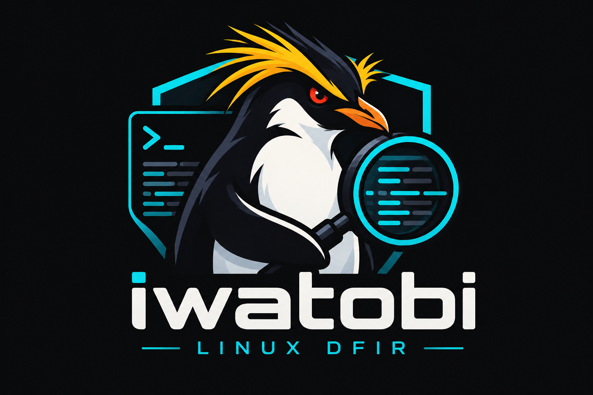

<div align="center">
 
 <p>
   <b>Iwatobi (イワトビ) is a Sigma-based threat hunting and fast forensics timeline generator for Linux logs.</b><br/>
   Created by <a href="https://github.com/Yamato-Security">Yamato Security</a> and written in
   <a href="https://www.rust-lang.org/">Rust</a> — imagine
   <a href="https://github.com/Yamato-Security/hayabusa">Hayabusa</a>, but for Linux text logs.
 </p>
 <p>
    <a href="https://github.com/Yamato-Security/iwatobi/blob/main/LICENSE"></a>
    <a href="https://twitter.com/SecurityYamato"></a>
 </p>
</div>

---

## 🐧 About

Iwatobi — named after the rockhopper penguin (イワトビペンギン) — is a **threat hunting and fast
forensics timeline generator for Linux logs**, written in memory-safe Rust. It reads the text logs a
Linux server actually has (syslog, `auth.log`, `cron`, Apache and nginx access and error logs, PHP
and php-fpm logs), runs native [Sigma](https://github.com/SigmaHQ/sigma) rules over them with the
same [sigma-rust](https://github.com/Yamato-Security/sigma-rust) engine that powers
[Suzaku](https://github.com/Yamato-Security/suzaku), and gives you a DFIR timeline with only the
events you need.

Iwatobi ships with the SigmaHQ Linux and web server rules it can run, plus a new rule set for the
PHP2Shell vulnerabilities (CVE-2026-109618 / CVE-2026-109619) that was validated against published
honeypot evidence of confirmed remote code execution.

## ✨ Features

- **One command, three inputs**: `dfir-timeline` scans a single file (`-f`), a directory tree
  (`-d`, rotated `.1` / `.2.gz` files included) or the **live system** (`-l`), where Iwatobi finds
  the log files the loaded rules need, asks you for a directory when a log source is missing (or
  skips those rules), and falls back to the systemd journal via `journalctl` on hosts without syslog
  files.
- **Native Sigma** with correct keyword semantics (keywords match anywhere in the line), the Sigma
  web server field names (`c-ip`, `cs-method`, `cs-uri-query`, `sc-status`, `cs-user-agent`, ...) for
  access logs, and **Sigma correlation rules** (`event_count`, `value_count`, `temporal`,
  `temporal_ordered`) evaluated with sliding time windows.
- **Formats**: RFC 3164 / RFC 5424 / rsyslog ISO syslog and `journalctl -o short-iso` output,
  vsftpd and ClamAV logs, Apache / nginx access logs (common, combined, vhost_combined, JSON lines),
  Apache 2.2/2.4 and nginx error logs, PHP error logs and php-fpm logs. PHP engine messages are
  recognised wherever they appear (Apache error log, nginx FastCGI stderr, php-fpm, syslog).
- **Output**: a colored timeline on the terminal (timestamp, rule title, level, computer, log
  source, details), and CSV / JSON / JSONL files with everything a DFIR report needs: MITRE ATT&CK
  tactics and techniques, every parsed field, rule file and ID, log file and line number. Profiles
  are configurable in `config/profiles.yaml`.
- **Timezone aware**: logs that carry no zone (syslog, Apache error log, php-fpm) are read in the
  zone you name with `-z` (default: local), output is local time or UTC (`-U`).
- Results summary, error log, formula-injection-safe CSV, control-character-safe terminal output,
  and the same option letters as Hayabusa and Suzaku.

## ⬇️ Download

Download the package for your platform from the
[Releases](https://github.com/Yamato-Security/iwatobi/releases) page. Each zip holds the binary, the
`rules/`, `config/` and `art/` folders, the license and this README:

| Package | Platform |
| --- | --- |
| `iwatobi-<version>-lin-x64-gnu.zip` | Linux x64 (glibc) |
| `iwatobi-<version>-lin-x64-musl.zip` | Linux x64, statically linked (runs on any distribution) |
| `iwatobi-<version>-lin-aarch64-gnu.zip` | Linux ARM64 (glibc) |
| `iwatobi-<version>-lin-aarch64-musl.zip` | Linux ARM64, statically linked |
| `iwatobi-<version>-mac-aarch64.zip` / `-mac-x64.zip` | macOS Apple silicon / Intel |
| `iwatobi-<version>-win-x64.zip` / `-win-x86.zip` / `-win-aarch64.zip` | Windows |
| `iwatobi-<version>-all-platforms.zip` | every binary above with one copy of the rules |

```bash
unzip iwatobi-0.1.0-lin-x64-musl.zip -d iwatobi
cd iwatobi
chmod +x iwatobi-0.1.0-lin-x64-musl
./iwatobi-0.1.0-lin-x64-musl help
```

Keep the `rules/` folder next to the binary (or pass `-r`). The musl builds are the easiest choice
for incident response because they run on old and minimal distributions alike. The macOS and
Windows builds scan logs copied off a Linux machine (`-f`, `-d`); live analysis (`-l`) is Linux only.
On macOS, remove the download quarantine first if needed: `xattr -d com.apple.quarantine iwatobi-*`.

## 🛠️ Build from source

```bash
git clone https://github.com/Yamato-Security/iwatobi.git
cd iwatobi
cargo build --release
./target/release/iwatobi -h
```

Iwatobi needs Rust 1.88 or later. The `config/` and `art/` files are embedded in the binary (a copy
in `./config/` next to the binary overrides them); keep the `rules/` directory next to the binary or
pass `-r`.

## 🚀 Usage

```bash
# one file
iwatobi dfir-timeline -f /var/log/auth.log

# a directory of logs copied off a server (timestamps without a zone were written in UTC)
iwatobi dfir-timeline -d ./evidence/var/log -z UTC

# the local system (run as root to read every log)
sudo iwatobi dfir-timeline -l

# save CSV and JSONL with the verbose profile, in UTC, sorted by time
iwatobi dfir-timeline -d ./evidence/var/log -z UTC -U -s -o timeline -t csv,jsonl
```

### `dfir-timeline` options

```
Input:
  -d, --directory <DIR>     Directory of log files (scanned recursively; rotated and .gz files included)
  -f, --file <FILE>         File path to one log file
  -l, --live-analysis       Analyze the local log files that the loaded rules need (/var/log, journalctl)
      --log-format <FORMAT> Force the log format of every input file instead of detecting it: syslog,
                            applog, access, access-json, apache-error, nginx-error, php-error, php-fpm

General Options:
  -r, --rules <DIR/FILE>    Specify a custom rule directory or file (default: ./rules)
  -z, --timezone <TZ>       Timezone of log timestamps that have no timezone information
                            (ex: UTC, Asia/Tokyo, +09:00) (default: local)
  -Q, --quiet-errors        Quiet errors mode: do not save error logs
  -w, --no-wizard           Do not ask questions (live analysis skips rules whose logs are not found)
      --threads <NUMBER>    Number of threads (default: optimal number for performance)

Filtering:
  -m, --min-level <LEVEL>   Minimum level for rules to load (default: informational)
  -D, --enable-deprecated-rules / -u, --enable-unsupported-rules
      --exclude-status / --include-status <STATUS...>
      --include-tag / --exclude-tag <TAG...>
      --timeline-start / --timeline-end <DATE>   RFC 3339 bounds for the events to load
      --time-offset <OFFSET>  Scan recent events based on an offset (ex: 1y, 3M, 30d, 24h, 30m)

Output:
  -o, --output <FILE>       Save the results to a file. The extension is set to the output type
                            (ex: -o timeline -t csv,jsonl writes timeline.csv and timeline.jsonl)
  -t, --output-type <FORMAT,...>  csv (default), json, jsonl
  -C, --clobber             Overwrite files when saving
  -p, --profile <PROFILE>   Output profile (default: standard on the terminal, verbose for files)
  -s, --sort                Sort events before output (warning: this uses much more memory!)
  -N, --no-summary          Do not display the results summary
  -U, --utc                 Output time in UTC format (default: local time)

Display Settings:
  -K, --no-color            Disable color output
  -q, --quiet               Quiet mode: do not display the launch banner
  -v, --verbose             Output verbose information (detected log formats, skipped files)
```

### Live analysis

`-l` collects the log sources of every loaded rule and looks them up in
`config/log_locations.yaml` (`/var/log/syslog*`, `/var/log/auth.log*`, `/var/log/apache2/*`,
`/var/log/nginx/*`, `/var/log/php*`, ...). When a log source has no file on the host, Iwatobi asks
whether to enter a directory or skip the rules that need it; `-w, --no-wizard` skips without
asking, which is also what happens when Iwatobi is not attached to a terminal. On a host with only
journald, the journal is exported with `journalctl -o short-iso-precise` and scanned as syslog. Run
live analysis as root (or as a member of `adm` / `systemd-journal`) to read every log.

### Timestamps

Syslog (RFC 3164), Apache error log, nginx error log and php-fpm lines carry no timezone. Iwatobi
reads them in the zone given with `-z` (default: the local zone of the machine running Iwatobi).
Access logs, ISO syslog lines and PHP error log lines with a zone token (`[24-Oct-2026 15:35:33 UTC]`)
carry their own zone and are used as written; PHP lines without one are read with `-z` too.
Output is local time by default, UTC with `-U`. RFC 3164 lines also lack a year: the year of the
file's modification time is assumed, minus one for lines that would otherwise be in the future.

### Output profiles

| Profile | Columns |
| --- | --- |
| `minimal` | Timestamp, RuleTitle, Level, Details |
| `standard` (terminal default) | Timestamp, RuleTitle, Level, Computer, LogSource, Details |
| `verbose` (file default) | standard + MitreTactics, MitreTags, OtherTags, LineNumber, ExtraFieldInfo, RuleFile, RuleID, LogFile |
| `super-verbose` | verbose + RawLine, RuleAuthor, RuleCreationDate, RuleModifiedDate, Status, Description, References, FalsePositives |
| `all-field-info`, `all-field-info-verbose` | every parsed field instead of Details / ExtraFieldInfo |

`Details` holds the key fields of the event (`Proc`, `PID`, `Msg` for syslog; `SrcIP`, `Method`,
`URI`, `Status`, `Bytes`, `Referer`, `UA` for access logs; ...) and `ExtraFieldInfo` the rest. In
CSV and on the terminal they are rendered as `Key: value ¦ Key: value`; in JSON/JSONL they are
objects. Run `iwatobi list-profiles` to see the exact columns.

## 📏 Rules

Rules live in [`rules/`](rules/README.md): `rules/sigma/` mirrors the SigmaHQ repository layout for
the upstream rules Iwatobi runs, `rules/iwatobi/` holds rules written for Iwatobi. A rule is loaded
when its `logsource` is one Iwatobi can produce:

| Sigma `logsource` | Log |
| --- | --- |
| `product: linux` + `service: syslog` / `auth` / `sshd` / `cron` / `sudo` / `vsftpd` / `clamav` / `guacamole` | syslog-family files, `journalctl` output, vsftpd / ClamAV logs |
| `category: webserver` | Apache / nginx access logs |
| `service: apache` (or `product: apache, service: error`) | Apache error log |
| `service: nginx` (or `product: nginx, service: error`) | nginx error log |
| `product: php, service: error_log` | PHP error log and PHP messages in other logs |
| `product: php, service: fpm` | php-fpm log |

Rules for auditd, Sysmon for Linux and web proxies are not supported yet and are skipped at start-up
(the count is shown).

### PHP2Shell (CVE-2026-109618 / CVE-2026-109619)

`rules/iwatobi/php/php2shell/`, `rules/iwatobi/web/` and `rules/iwatobi/php/fpm/` detect the
PHP2Shell exploit chain from the traces it leaves in ordinary logs, confirmed against the 35 RCE
cases published in [0x4D31/honeypot-data](https://github.com/0x4D31/honeypot-data/tree/main/reports/php2shell):

| Rule | Log | Level |
| --- | --- | --- |
| PHP Memory Exhausted Before Script Execution | PHP error log (`in Unknown on line 0`) | high |
| PHP Session ID Too Long Or Illegal Characters | PHP error log | high |
| PHP Outbound HTTP Request From Command Line Code | PHP error log (`php -r` call-backs) | medium |
| PHP POST Content-Length Exceeds Limit | PHP error log | low |
| Apache Worker Process Exited On Abort Or Bus Error Signal | Apache error log (with SigmaHQ's segfault rule) | high |
| Shell Error Output In Apache Error Log | Apache error log (`sh: 1: wget: not found`) | high |
| PHP-FPM Child Process Exited On Signal / PHP-FPM Child Shell Error Output | php-fpm log | high |
| PHP2Shell PoC Memory Pressure Request | access log (`q0000000=v&q0000001=v...`) | high |
| Rapid Repeated POST Requests To PHP Index Page | access log, correlation (3 POSTs / 60 s per client) | medium |
| PHP2Shell Exploitation Chain | correlation of OOM + session ID + worker crash within 5 minutes | critical |

The fixtures under `test_files/php2shell/` are derived from that evidence (CC BY 4.0); scan them with
`iwatobi dfir-timeline -d test_files/php2shell -z UTC` (the Apache error log carries no zone while
the PHP log is in UTC).

#### Try it on the original PHP2Shell honeypot evidence

The honeypot logs are published by [0x4D31/honeypot-data](https://github.com/0x4D31/honeypot-data)
under CC BY 4.0. Get them with any of these (the whole repository is about 11 MB):

```bash
# 1. shallow clone of the whole repository
git clone --depth 1 https://github.com/0x4D31/honeypot-data.git

# 2. or only the PHP2Shell reports (sparse checkout)
git clone --depth 1 --filter=blob:none --sparse https://github.com/0x4D31/honeypot-data.git
git -C honeypot-data sparse-checkout set reports/php2shell

# 3. or without git: download and unzip the repository archive
curl -L -o honeypot-data.zip https://github.com/0x4D31/honeypot-data/archive/refs/heads/main.zip
unzip -q honeypot-data.zip && mv honeypot-data-main honeypot-data
```

The confirmed-RCE evidence is in `honeypot-data/reports/php2shell/2026-10-24-rce-evidence/`: one
folder per case (`episode-a/A01` ... `episode-b/B32`), each with the Apache JSON access log
(`web.jsonl`), the PHP error log, the Apache error log and the Apache child stderr. Scan the whole
tree with `-z UTC`, because the Apache error logs carry no timezone while the PHP error logs are in
UTC:

```bash
EVIDENCE=honeypot-data/reports/php2shell/2026-10-24-rce-evidence

# timeline on the terminal (UTC)
./iwatobi dfir-timeline -d "$EVIDENCE" -z UTC -U

# only high and critical alerts, without the summary
./iwatobi dfir-timeline -d "$EVIDENCE" -z UTC -U -m high -N

# save sorted CSV and JSONL with the verbose profile (rule, MITRE tags, log file and line)
./iwatobi dfir-timeline -d "$EVIDENCE" -z UTC -U -s -o php2shell-timeline -t csv,jsonl

# one case only
./iwatobi dfir-timeline -d "$EVIDENCE/episode-a/A01" -z UTC -U
```

(`./iwatobi` stands for the binary from the package, e.g. `./iwatobi-0.1.0-lin-x64-musl`.) The
packet captures (`traffic.pcap.gz`), Tetragon process events and case metadata are not text logs
Iwatobi parses; they are skipped and listed in the error log (`-v` shows them). The 284 files scanned
in Iwatobi 0.1.0's validation produced:

| Rule | Detections |
| --- | ---: |
| PHP Memory Exhausted Before Script Execution | 139 |
| Apache Segmentation Fault | 83 |
| PHP2Shell PoC Memory Pressure Request | 52 |
| PHP Session ID Too Long Or Illegal Characters | 51 |
| Shell Error Output In Apache Error Log | 29 |
| Rapid Repeated POST Requests To PHP Index Page (correlation) | 27 |
| PHP2Shell Exploitation Chain (correlation) | 12 |
| PHP Outbound HTTP Request From Command Line Code | 9 |
| Apache Worker Process Exited On Abort Or Bus Error Signal | 7 |

All 35 confirmed RCE cases are flagged. The counts are higher than in `test_files/php2shell/`
because the published case folders overlap in time and repeat some log lines.

## 🧪 Development

```bash
cargo fmt --all -- --check
cargo clippy --all-targets -- -D warnings
cargo test
```

The integration tests in `tests/cli.rs` run the binary against `test_files/` and assert detection
counts that were derived by hand from the fixture lines.

## 🤝 Contributing & License

Bug reports, log samples that do not parse and new rules are welcome as issues and pull requests.
Iwatobi is released under the [AGPLv3](LICENSE) and
copyright Yamato Security.
